# ⚒️ Data Forge

A game that tracks my journey to mastering data-engineering fundamentals.
Every quest is one core skill. A quest only counts when its **gate test passes**
and I've **explained it back in my own words** — no claiming XP, only earning it.

Every push re-strikes the gates and redraws this board.

<!-- FORGE:START -->

### ⚒️ Rank: **Cinder** — _the forge is cold — strike the first spark_

`░░░░░░░░░░░░░░░░░░░░░░░░` **0 XP** · 150 XP to **Striker**

**Quests:** 0/17 forged · **Streak:** 0 day(s) · **Days at the anvil:** 0 · **Forge heat:** ❄️

#### 📣 Last push
- 🔥 The forge is lit for the first time. Your journey begins.

#### 🎯 Next on the anvil
- 🟠 **q01 · Two Kinds of Database** (+100 XP)

#### 🗺️ The map

| Region | State | Quests |
|---|---|---|
| Foundry Floor | 🔥 active | 0/2 |
| Query Crucible | 🔒 locked | 0/4 |
| Ore Mines | 🔒 locked | 0/3 |
| Shaping Anvil | 🔒 locked | 0/2 |
| Long Furnace | 🔒 locked | 0/3 |
| Passport Office | 🔒 locked | 0/1 |
| Cloud Citadel | 🔒 locked | 0/2 |

📜 Full quest log

| | Quest | Region | XP | Teaches |
|---|---|---|---|---|
| 🟠 | **q01** Two Kinds of Database | Foundry Floor | 100 | OLTP vs OLAP; row vs columnar storage — why analytics scans less |
| 🔒 | **q02** Light the Warehouse | Foundry Floor | 150 | DuckDB as an OLAP engine; schemas; medallion (bronze/silver/gold) layers |
| 🔒 | **q03** Weigh the Ore | Query Crucible | 150 | GROUP BY, aggregates, HAVING, ORDER BY |
| 🔒 | **q04** Windows into the Fire | Query Crucible | 200 | Window functions — running totals, ranking, PARTITION BY |
| 🔒 | **q05** Read the Smoke | Query Crucible | 200 | Reading EXPLAIN query plans; finding the expensive operation |
| ⚒️ | **q06** Join the Metals | Query Crucible | 200 | Joins, CTEs, NULL traps, fan-out duplication |
| ⚒️ | **q07** Ore from the Mountain | Ore Mines | 150 | Python ingestion of CSV/JSON; raw is immutable; lineage columns |
| ⚒️ | **q08** Parquet Ingots | Ore Mines | 150 | File formats (CSV vs Parquet), compression, partitioning |
| ⚒️ | **q09** Rivers and Buckets | Ore Mines | 200 | Batch vs streaming; incremental loads with watermarks |
| ⚒️ | **q10** Facts and Dimensions | Shaping Anvil | 200 | Dimensional modelling, star schemas, grain |
| ⚒️ | **q11** Slowly Changing Ore | Shaping Anvil | 200 | Slowly changing dimensions (SCD Type 2) — keeping history |
| ⚒️ | **q12** Strike Twice, Same Blade | Long Furnace | 250 | Idempotency — upserts/MERGE, truncate-and-reload, run keys |
| ⚒️ | **q13** Quality at the Gate | Long Furnace | 200 | Data quality checks, data contracts, quarantine instead of silent drops |
| ⚒️ | **q14** The Conductor | Long Furnace | 200 | Orchestration — DAGs, dependencies, retries, backfills |
| ⚒️ | **q15** Your Database Has a Passport | Passport Office | 300 | PII masking vs hashing vs tokenising; residency; POPIA cross-border rules |
| ⚒️ | **q16** Ascend to the Cloud | Cloud Citadel | 250 | Mapping the local stack to S3, Glue, Athena, Redshift; regions & cost |
| 🔒 | **q17** Boss: Explain the Forge | Cloud Citadel | 400 | Mock interview — defend every design choice in passport-pipeline out loud |

Legend: ✅ forged · 🔨 half-done · 🟠 available · 🔒 locked · ⚒️ gate not forged yet

Board regenerated automatically on push · 2026-10-09
<!-- FORGE:END -->

---

**How it works:** [GAME.md](GAME.md) · **How the mentor sessions run:** [MENTOR.md](MENTOR.md) ·
**The quests:** [quests/quests.yml](quests/quests.yml)

Companion project: [passport-pipeline](https://github.com/Kananelodev/passport-pipeline) —
several quests map directly onto its iterations.
